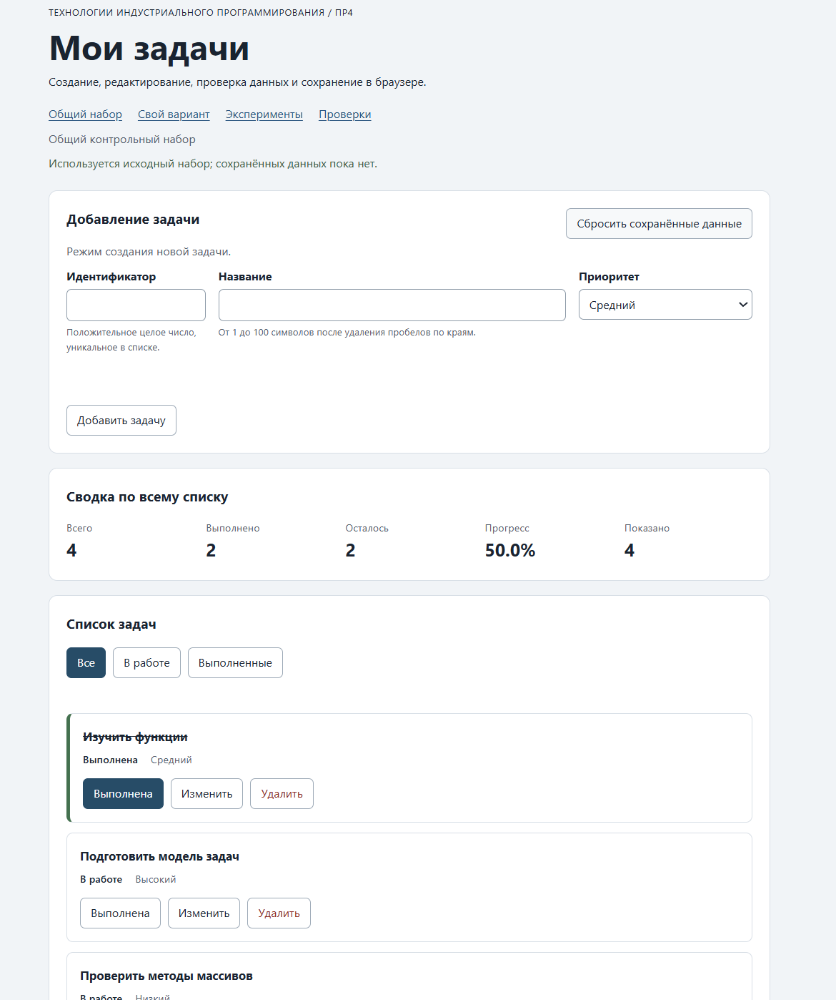

# Практическая работа № 4. Формы, валидация и локальное хранение данных

## Данные работы

| Поле | Значение |
|---|---|
| Имя | Елизавета  |
| Группа | ЭФБО-05-25 |
| Вариант из ПР2–ПР3 | 1 |
| Node.js | v24.21.0 |
| Браузер | Microsoft Edge|
| Операционная система | Windows |

Это шаблон отчёта. Формулировки «Заполнить» и ожидаемые примеры необходимо заменить фактическими результатами.

## Запуск

Рабочая папка: `practice-04` внутри личного репозитория.

```bash
npm test
npm start
```

Устанавливать зависимости через `npm install` не требуется.

```text
http://127.0.0.1:5504/
http://127.0.0.1:5504/index.html?dataset=variant
http://127.0.0.1:5504/examples/forms-storage.html
http://127.0.0.1:5504/checks.html
```

Если использован другой порт, указать фактическую команду и адрес.

## Перенос результата ПР3

Указать, какие модули перенесены из ПР3, какие исправления потребовались и какой результат показали повторные проверки сервиса.

| Файл | Что перенесено или изменено |
|---|---|
| `data.js` | Перенесён без изменений (demoTasks + variantTasks) |
| `task-service.js` | Перенесены 9 функций, добавлена `updateTask` |
| `task-selectors.js` | Перенесена `getVisibleTasks` |
| `task-view.js` | Перенесены 4 функции, в карточку добавлена кнопка `edit` |

## Эксперименты с формой и хранилищем

| № | До запуска: прогноз | После запуска: результат | Объяснение |
|---:|---|---|---|
| 1. Пустое обязательное поле | Браузер не отправит форму, сработает HTML-валидация | Submit не произошел, журнал не изменился, браузер показал стандартное сообщение о пустом поле | HTML-атрибут required блокирует отправку до вызова JavaScript-обработчика. Событие submit не возникает |
| 2. Название из пробелов | required пропустит, сработает прикладная проверка через trim() | Появилось сообщение «Название не должно состоять только из пробелов», журнал показал, что прикладная проверка отклонила значение | required проверяет только наличие символов, а не их содержимое. Строка из пробелов не пуста для HTML, но после trim() превращается в пустую строку. Прикладная проверка отклоняет её через setCustomValidity() |
| 3. Типы значений `FormData` | FormData вернёт строку, даже если поле выглядит как число. defaultPrevented = true. Название обрежется. | typeof FormData title: string, submit.defaultPrevented: true, в журнале название без пробелов | FormData.get() всегда возвращает строку (или File). preventDefault() отменяет перезагрузку. Метод trim() убирает пробелы по краям до сохранения |
| 4. Строка в `localStorage` и JSON | getItem вернёт строку JSON. JSON.parse даст объект. | typeof localStorage value: string. raw — строка с экранированными кавычками, parsed — объект с полями title и priority | localStorage хранит только строки. Для объекта нужно JSON.stringify() при записи и JSON.parse() при чтении. raw показывает исходную строку, parsed — восстановленный объект |
| 5. Повреждённый JSON | JSON.parse() упадёт с ошибкой SyntaxError, сработает try/catch | В журнале «JSON.parse завершился ошибкой», raw = {broken-json} | localStorage хранит любую строку, не проверяя её. JSON.parse требует валидный JSON и бросает исключение. В коде используется try/catch, чтобы не сломать страницу |

## Организация кода

- `task-service.js` — чистые функции ПР2 с добавленной `updateTask`, не работает с DOM и storage.
- `form-validation.js` — чистая функция `validateTaskDraft`, не обращается к DOM.
- `task-storage.js` — четыре функции хранения, принимают `storage` аргументом для тестируемости.
- `task-view.js` — создание DOM-карточек, списка и сводки.
- `main.js` — состояние (`currentTasks`, `currentFilter`, `editingId`), обработка событий и координация.

Функции хранения получают `storage` аргументом, чтобы их можно было проверить с объектом-имитацией без реального `window.localStorage`. Данные из JSON проверяются до использования (`isValidTaskList`), потому что успешный `JSON.parse` не гарантирует корректность модели

## Проверка формы

| Сценарий | Ожидаемый результат | Фактический результат | Итог |
|---|---|---|---|
| Добавление корректной задачи | Успех, запись в storage | Задача добавлена, storage записан | Пройдено |
| Повторяющийся id | Отказ без изменения списка | Сообщение об ошибке у поля, список не изменился | Пройдено |
| Пустое название | Отказ | Нативная проверка `required` не пропустила | Пройдено |
| Название из пробелов | Отказ прикладной проверки | Сообщение «Название не может быть пустым» | Пройдено |
| Название длиной 100 | Успех | Задача добавлена | Пройдено |
| Название длиной 101 | Отказ | `maxlength` + прикладная проверка | Пройдено |
| Редактирование title и priority | Меняется одна задача, статус сохраняется | `completed` не сброшен | Пройдено |
| Отмена редактирования | Возврат к пустой форме создания | Форма пуста, `id` разблокирован | Пройдено |

## Общий сценарий

Записать фактические результаты последовательности из раздела 6.8 методички.

| Шаг | Действие | Видимые id | Всего | Выполнено | Осталось | Прогресс | Состояние storage |
|---:|---|---|---:|---:|---:|---:|---|
| 0 | Исходный запуск после сброса | [1, 4, 7, 10] | 4 | 2 | 2 | 50.0% | ключ отсутствует |
| 1 | Добавление `id = 20` | [1, 4, 7, 10, 20] | 5 | 2 | 3 | 40.0% | запсиано |
| 2 | Отказ для повторного `id = 4` | [1, 4, 7, 10, 20] | 5 | 2 | 3 | 40.0% | без изменений |
| 3 | Редактирование `id = 4` | [1, 4, 7, 10, 20] | 5 | 2 | 3 | 40.0% | записано |
| 4 | Переключение `id = 7` | [1, 4, 7, 10, 20] | 5 | 3 | 2 | 60.0% | записано |
| 5 | Удаление `id = 1` | [4, 7, 10, 20] | 4 | 2 | 2 | 50.0% | записано |
| 6 | Перезагрузка страницы | [4, 7, 10, 20] | 4 | 2 | 2 | 50.0% | восстановлено |
| 7 | Сброс данных | [1, 4, 7, 10] | 4 | 2 | 2 | 50.0% | ключ удалён |

## Проверка восстановления и ошибок

| Случай | Ожидание | Фактический результат | Итог |
|---|---|---|---|
| Записи нет | Независимая копия исходного набора | Показаны 4 исходные задачи, `storageKey` не создан | Пройдено |
| Корректная запись | Данные восстанавливаются после перезагрузки | После F5 задача `id=20` на месте | Пройдено |
| Повреждённый JSON | Исходный набор и предупреждение | Список исходный, статус-бар жёлтый | Пройдено |
| Неверная версия или схема | Исходный набор и предупреждение | `version: 999` отклонён, fallback сработал | Пройдено |
| Сброс | Удаляется только текущий ключ | `tip-js-practice-04:demo` удалён, другие ключи целы | Пройдено |
| Общий и индивидуальный наборы | Изменения не смешиваются | Ключи `demo` и `variant` изолированы | Пройдено |


## Индивидуальный вариант

Исходный набор варианта 1: 6 задач `[11, 23, 37, 41, 58, 64]`, изначально ни одна не выполнена

| Этап | Всего | Выполнено | Осталось | Прогресс | Видимые id |
|---|---:|---:|---:|---:|---|
| Исходный набор | 6 | 0 | 6 | 0.0% | [11, 23, 37, 41, 58, 64] |
| После добавления `75` | 7 | 0 | 7 | 0.0% | [11, 23, 37, 41, 58, 64, 75] |
| После редактирования `23` | 7 | 0 | 7 | 0.0% | [11, 23, 37, 41, 58, 64, 75] |
| После удаления `37` | 6 | 0 | 6 | 0.0% | [11, 23, 41, 58, 64, 75] |
| После перезагрузки | 6 | 0 | 6 | 0.0% | [11, 23, 41, 58, 64, 75] |
| После сброса | 6 | 0 | 6 | 0.0% | [11, 23, 37, 41, 58, 64] |

Общий набор `[1, 4, 7, 10]` после действий в варианте не изменился, ключи `tip-js-practice-04:demo` и `tip-js-practice-04:variant` изолированы

## Протокол проверок сервиса

Вставить реальный вывод `npm run check:service`.

```text
OK: 01. Создание задачи с явным приоритетом
OK: 02. Приоритет по умолчанию
OK: 03. Удаление краевых пробелов без изменения внутренних
OK: 04. Граничные длины названия и положительный безопасный id
OK: 05. Некорректные названия при создании
OK: 06. Некорректные идентификаторы при создании
OK: 07. Все допустимые приоритеты и отклонение недопустимых
OK: 08. Каждый вызов createTask возвращает новый объект
OK: 09. Поиск по id, а не по индексу
OK: 10. Отсутствующая задача и пустой массив при поиске
OK: 11. Поиск не преобразует строковый id в число
OK: 12. Получение невыполненных задач
OK: 13. Пустой список, все выполнены и все не выполнены
OK: 14. Названия в исходном порядке и пустой список
OK: 15. Сводка по общему набору
OK: 16. Сводка по пустому списку
OK: 17. Сводка: ничего не выполнено и выполнено всё
OK: 18. Процент остаётся числом без предварительного округления
OK: 19. Добавление в конец без изменения входного массива
OK: 20. Добавление в пустой список с приоритетом по умолчанию
OK: 21. Повторяющийся id отклоняется
OK: 22. Добавление не обходит проверки createTask
OK: 23. Изменение completed в обе стороны
OK: 24. completed принимает только boolean
OK: 25. Некорректный или отсутствующий id при изменении статуса
OK: 26. Повторная установка статуса создаёт новый результат
OK: 27. Переименование сохраняет остальные поля
OK: 28. Проверки названия при переименовании
OK: 29. Некорректный или отсутствующий id при переименовании
OK: 30. Удаление по id с сохранением порядка
OK: 31. Удаление единственной записи
OK: 32. Некорректный, отсутствующий id и удаление из пустого списка
OK: 33. Входные объекты не изменяются ни одной операцией
OK: 34. Общий сценарий и все промежуточные сводки
OK: 35. Работа с другим набором, без зависимости от demoTasks

Проверок пройдено: 35; не пройдено: 0.
```

## Протокол проверок новых модулей

Вставить реальный вывод `npm run check:modules`.


```text
OK: 01. updateTask изменяет название и приоритет выбранной задачи
OK: 02. updateTask нормализует название и сохраняет completed
OK: 03. updateTask не изменяет входной массив и объекты
OK: 04. updateTask отклоняет некорректный и отсутствующий id
OK: 05. updateTask отклоняет некорректные название и приоритет
OK: 06. Валидация создания нормализует поля
OK: 07. Валидация отклоняет некорректные id
OK: 08. Валидация отклоняет повторяющийся id при создании
OK: 09. Валидация проверяет название после trim
OK: 10. Валидация принимает только три приоритета
OK: 11. В режиме редактирования используется editingId
OK: 12. Редактирование отсутствующей задачи отклоняется
OK: 13. Валидация не изменяет draft и список
OK: 14. Проверка схемы принимает корректный список
OK: 15. Проверка схемы отклоняет неверную структуру
OK: 16. Отсутствующая запись возвращает независимую копию исходных данных
OK: 17. Корректная запись восстанавливается из хранилища
OK: 18. Повреждённый JSON приводит к безопасному fallback
OK: 19. Неизвестная версия приводит к безопасному fallback
OK: 20. Некорректные задачи из JSON не принимаются
OK: 21. Ошибка getItem перехватывается
OK: 22. Сохранение записывает версию и задачи
OK: 23. Некорректный список не записывается
OK: 24. Ошибка setItem перехватывается
OK: 25. Удаляется только переданный ключ
OK: 26. Ошибка removeItem перехватывается
OK: 27. Результат загрузки не разделяет объекты с fallback

Проверок пройдено: 27; не пройдено: 0.
```

## Протокол браузерных проверок

Вставить реальный текст из блока «Текстовый протокол» на `checks.html`.

```text
OK: Фильтры ПР3 сохраняют порядок и не изменяют вход
OK: Карточка содержит toggle, edit и delete
OK: Название задачи выводится как текст
OK: Повторная отрисовка списка не накапливает карточки
OK: Сводка использует полный список и отдельный visibleCount
OK: Пустые состояния различают список и фильтр
OK: Приложение запускается с исходным набором
OK: Корректная форма добавляет задачу и сохраняет данные
OK: Повторяющийся id отклоняется без записи
OK: Название из пробелов отклоняется прикладной проверкой
OK: Нативные ограничения не пропускают пустую форму
OK: Кнопка edit заполняет форму и блокирует id
OK: Редактирование меняет title и priority, сохраняя completed
OK: Отмена редактирования возвращает режим создания
OK: Успешная отправка очищает ошибки и форму
OK: Изменение статуса сохраняется
OK: Удаление сохраняется
OK: Фильтр не записывается, но сохраняется после изменения данных
OK: Перезагрузка восстанавливает сохранённые задачи
OK: Сброс удаляет ключ и восстанавливает исходный набор
OK: Повреждённый JSON не ломает запуск
OK: Некорректная схема из storage заменяется исходным набором
OK: Общий и индивидуальный наборы используют разные ключи

Всего: 23. Пройдено: 23. Ошибок: 0.
```

## Собственные проверки

| № | Исходное состояние и действия | Ожидаемый результат | Фактический результат | Итог |
|---:|---|---|---|---|
| 1 | Форма создания, ввести id=30 и название ровно из 100 символов (`"a".repeat(100)`). | Успех, задача добавляется. | Задача появилась в конце списка, её название содержит ровно 100 символов, `localStorage` обновился. | Пройдено |
| 2 | Добавить задачу id=20, перезагрузить страницу (F5), открыть фильтр «Все». | Задача id=20 сохраняется и отображается после перезагрузки. | id=20 на месте, статус `completed: false` сохранён. | Пройдено |
| 3 | Через DevTools: `localStorage.setItem("tip-js-practice-04:demo", "{broken-json")`, перезагрузить страницу, затем нажать «Сбросить сохранённые данные». | Приложение запускается с исходными 4 задачами и предупреждением. Сброс очищает повреждённый ключ. | Список исходный (4 задачи), статус-бар показывает ошибку в жёлтой рамке, кнопка сброса удаляет ключ, восстанавливает исходный набор. | Пройдено |

## Отладка и клавиатура

Точка останова в `handleFormSubmit`. При отправке формы с `id=20`:
- `draft` = `{ id: "20", title: "Тестовая задача", priority: "medium" }`.
- `validateTaskDraft` вернул `{ ok: true, value: { id: 20, title: "Тестовая задача", priority: "medium" } }`.
- `addTask` вернул `{ ok: true, tasks: [...] }` с 5 задачами.
- `saveTasks` записал строку: `{"version":1,"tasks":[...]}`.

Ошибочный сценарий повторного `id=4`: `validateTaskDraft` вернул `{ ok: false, errors: { id: "Задача с таким id уже существует" } }`, список не изменился.

**Клавиатура.** Tab переключает поля формы, Enter отправляет форму, Space активирует кнопки. При начале редактирования фокус переходит в поле названия, при отмене — в поле id.

## Вид приложения



## Дополнительное задание

Не выполнено

## Вывод

В ходе работы изучена обработка форм через событие `submit` и `FormData`, разделение нативной HTML-валидации и прикладной проверки. Реализован режим редактирования через единую форму. Организовано хранение данных в `localStorage` с проверкой схемы и обработкой повреждённого JSON через fallback. Операции сохраняются между перезагрузками, общий и индивидуальный наборы изолированы разными ключами. Исправлены ошибки, связанные с отсутствием экспорта `updateTask` и заглушками в `handleFilterClick`. Все 35 проверок сервиса, 27 проверок новых модулей и 23 браузерных сценария пройдены